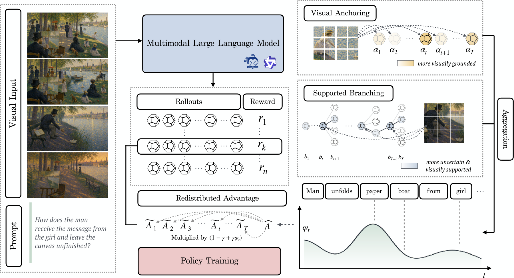

# Gaze-RL

Code for **Eyes in the Update? Learning Where Rewards Land in Multimodal Reasoning**.

<p align="center"></p>

In outcome-reward RL for vision-language models, every token of a response receives the same advantage, although the visual evidence is used at only a few places in the response. Gaze-RL leaves the verifier, the data, the group-relative advantage and the model unchanged and only decides where the advantage of each rollout lands. From the forward pass that scores the rollouts, it reads two signals at every response token: how strongly the state that produced the token is anchored to the image or video tokens, and how uncertain the policy was there, weighted by whether the position, or the earlier states it draws on, are visually anchored. The two signals form a landing field with mean one over each response, so every rollout keeps its total credit and only its distribution over tokens changes.

## Installation

```bash
git clone https://github.com/lixuan27/Gaze-RL-main.git
cd Gaze-RL-main
pip install -e .            # core: PyTorch only
pip install -e ".[infer]"   # inference with Hugging Face checkpoints
```

## Usage

### Landing weights

The field needs the hidden states and logits of the policy on the full sampled sequences, plus two masks over those sequences: the image or video tokens, and the sampled response tokens.

```python
from gaze_rl import LandingConfig, landing_field, token_entropy

out = policy(**inputs, output_hidden_states=True)
weights = landing_field(out.hidden_states, token_entropy(out.logits), vision_mask, response_mask, LandingConfig())
token_advantages = advantages[:, None] * weights   # [batch, seq_len]
```

`weights` is zero outside the responses and averages to one over the response tokens of each rollout. The token at position `p` is read from the state at `p - 1`, the state it was sampled from. `LandingConfig.layers` indexes `hidden_states` directly (entry 0 is the embedding output); its default is the layer set used for Qwen2.5-VL-7B, so set it for other decoders.

### In a GRPO loop

`prepare_rollouts` scores a batch of grouped rollouts once, with the policy that sampled them, and `gaze_rl_loss` gives the loss of every optimization step on that batch.

```python
from gaze_rl import LandingConfig, gaze_rl_loss, prepare_rollouts

# rollouts of one prompt are consecutive in the batch, group_size at a time
rollouts = prepare_rollouts(policy, reference, inputs, vision_mask, response_mask,
                            rewards, group_size=8, config=LandingConfig())

for _ in range(updates_per_batch):
    loss, stats = gaze_rl_loss(policy, inputs, rollouts, clip_eps=0.2, beta=1e-3)
    optimizer.zero_grad()
    loss.backward()
    optimizer.step()
```

`LandingConfig(gamma=0.0)` gives the uniform field and therefore plain GRPO, which makes a convenient baseline. With `keep_signals=True`, `rollouts.signals` holds the per-token anchoring, support, branching and weights for logging. [`examples/toy_update.py`](examples/toy_update.py) runs this loop on a tiny random model on CPU.

### Settings used in the paper

| | |
|---|---|
| Landing field | `gamma=0.70`, `eta=0.25`, `kappa=0.5`, `lag=0.1`, `chi=0.25`, `eps=1e-6` |
| Layers (Qwen2.5-VL-7B) | 14, 18, 22, 26 |
| Advantages | `(r - mean) / (std + 1e-3)` over each group, clipped to `[-2.5, 2.5]` |
| Policy loss | clip range 0.2, KL coefficient 1e-3 with the k3 estimator |

The field is computed in float32 without gradients and enters the loss as a constant. Its support kernel compares every response token with the earlier ones, which costs `O(T^2 d)` per rollout of `T` tokens, once per batch of rollouts.

## Inference

A trained policy keeps the architecture of its backbone, so inference is ordinary generation.

```bash
python -m gaze_rl.infer --model <checkpoint> --image demo.jpg --question "How many red cubes are there?"
python -m gaze_rl.infer --model <checkpoint> --video clip.mp4 --fps 0.5 --max-frames 8 --question "What happens after the door opens?"
```

```python
from gaze_rl.infer import GazeRLModel

model = GazeRLModel("<checkpoint>")
print(model("What is the value of x?", images=[image])["answer"])
```

Responses have the form `<think>...</think><answer>...</answer>`; `--prompt zh` selects the Chinese system prompt.

## Tests

```bash
pip install -e ".[test]"
pytest
```

The tests run on CPU in a few seconds and need no checkpoint.

## Citation

```bibtex
@article{he2026gazerl,
  title  = {Eyes in the Update? Learning Where Rewards Land in Multimodal Reasoning},
  author = {He, Lixuan and Chu, Tianzhe and Tian, Shulin and Zheng, Shikang and Chen, Feng and Ma, Yi},
  year   = {2026}
}
```

## License

MIT
